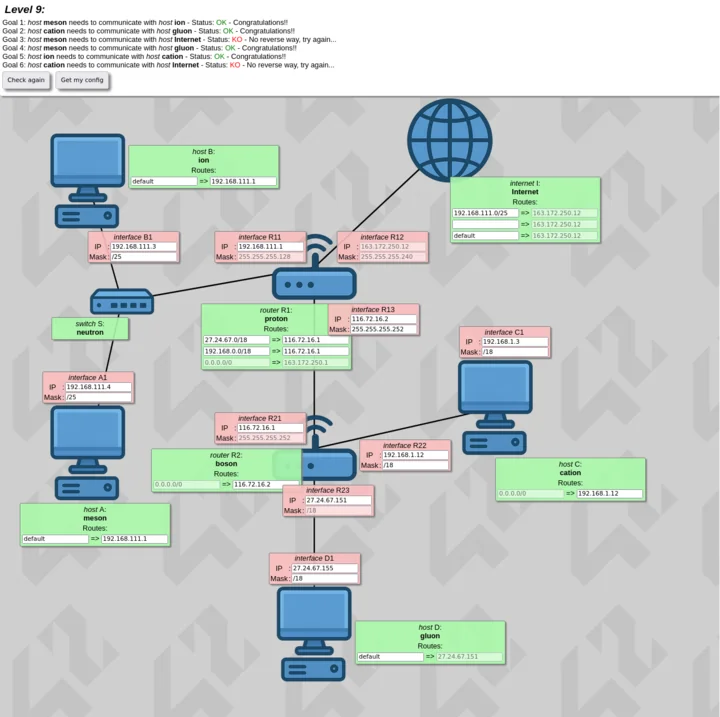

*This project has been created as part of the 42 curriculum by gpecelli.*

# NetPractice

An in-depth networking project from the **42 School** curriculum. NetPractice focuses on practical and theoretical computer networking, addressing schemes, subnetting, and packet routing across heterogeneous local and wide-area networks.

> [!NOTE]
> **42 Academic Integrity & Repository Scope**  
> In accordance with 42 school policies, proprietary evaluation binaries and simulation scripts (such as `run.sh` or local web server assets) are not distributed in this public repository. This repository contains the **10 exported configuration solutions** (`level1.json` to `level10.json`) and a comprehensive theoretical networking reference based on *Computer Networking: A Top-Down Approach*.

---

## Table of Contents
1. [Project Overview](#project-overview)
2. [Visual Overview & Exercises](#visual-overview--exercises)
3. [Theoretical Foundations (Top-Down Approach)](#theoretical-foundations-top-down-approach)
   - [Transport Layer: TCP vs UDP](#1-transport-layer)
   - [Network Layer: IPv4, Subnetting & Routing](#2-network-layer)
   - [Data Link Layer: MAC, Ethernet & ARP](#3-data-link-layer)
4. [Routing Logic & Network Devices](#routing-logic--network-devices)
5. [Repository Structure](#repository-structure)
6. [References](#references)

---

## Project Overview

NetPractice simulates real-world networking topologies consisting of **client hosts**, **switches**, **routers**, and **Internet interfaces**. 

Each level presents a misconfigured or incomplete network topology. The objective is to analyze IP assignments, calculate compatible subnets, configure netmasks, and define proper routing tables so that bidirectional communication is achieved between designated nodes.

During the 42 evaluation, a random set of network configurations must be diagnosed and solved within a strict 15-minute timeframe using only mental math or basic arithmetic utilities (such as `bc`).

---

## Visual Overview & Exercises



| Level | Focus Area | Solution File |
| :--- | :--- | :--- |
| **Levels 1–3** | Single subnets, host addressing, and basic subnet masks | [`level1.json`](file:///c:/Users/imgio/Desktop/net_practice/level1.json) – [`level3.json`](file:///c:/Users/imgio/Desktop/net_practice/level3.json) |
| **Levels 4–6** | Multi-interface routers, default gateways, and inter-subnet routing | [`level4.json`](file:///c:/Users/imgio/Desktop/net_practice/level4.json) – [`level6.json`](file:///c:/Users/imgio/Desktop/net_practice/level6.json) |
| **Levels 7–10** | Complex topologies, multiple routers, overlapping CIDR, and restricted routing tables | [`level7.json`](file:///c:/Users/imgio/Desktop/net_practice/level7.json) – [`level10.json`](file:///c:/Users/imgio/Desktop/net_practice/level10.json) |

---

## Theoretical Foundations (Top-Down Approach)

Comprehensive notes based on *Computer Networking: A Top-Down Approach* (Kurose & Ross), covering the key layers of the Internet protocol stack:

### 1. Transport Layer

The transport layer provides logical, process-to-process communication between application processes running on different hosts.

```
+--------------------------------------------------------------+
|                         APPLICATION                          |
+--------------------------------------------------------------+
                               |
                               v
+-------------------------------+------------------------------+
|              TCP              |             UDP              |
|  - Connection-Oriented        |  - Connectionless            |
|  - Reliable Data Transfer     |  - Best-Effort Delivery      |
|  - Flow & Congestion Control  |  - Minimal Header Overhead   |
+-------------------------------+------------------------------+
                               |
                               v
+--------------------------------------------------------------+
|                        NETWORK (IP)                          |
+--------------------------------------------------------------+
```

#### TCP (Transmission Control Protocol)
- **Connection-Oriented**: Requires a three-way handshake (`SYN` &rarr; `SYN-ACK` &rarr; `ACK`) prior to data transmission.
- **Reliable Data Transfer**: Employs sequence numbers, cumulative acknowledgments (`ACK`), and retransmission timers to guarantee in-order delivery without duplicates or losses.
- **Flow Control**: Uses a sliding receive window (`rwnd`) to prevent a fast sender from overwhelming a slow receiver buffer.
- **Congestion Control**: Adapts transmission rates dynamically to network capacity using algorithms such as Slow Start, Congestion Avoidance, Fast Retransmit, and Fast Recovery (AIMD).
- **Header Overhead**: 20 bytes minimum (can extend with options).

#### UDP (User Datagram Protocol)
- **Connectionless & Lightweight**: No handshake delay; packets are treated as independent datagrams.
- **Unreliable / Best-Effort**: No guarantees on packet delivery, ordering, or duplicate protection.
- **Header Overhead**: Fixed 8-byte header (`Source Port`, `Destination Port`, `Length`, `Checksum`).
- **Use Cases**: Latency-sensitive applications such as DNS queries, VoIP, live streaming, and real-time multiplayer gaming.

---

### 2. Network Layer

The network layer provides host-to-host communication services. It is responsible for routing packets across intermediate routers from source to destination.

#### IPv4 Addressing & CIDR
An IPv4 address consists of **32 bits**, grouped into four 8-bit octets represented in dotted-decimal format (e.g. `192.168.1.1`).

**CIDR (Classless Inter-Domain Routing)** splits the 32 bits into two segments:
- **Network Prefix (`/n`)**: The leading $n$ bits identify the network/subnet.
- **Host Identifier (`32 - n` bits)**: The remaining bits identify a unique interface within that subnet.

```
IPv4: 192.168.1.65 / 26
Binary: 11000000 . 10101000 . 00000001 . 01 000001
Mask:   11111111 . 11111111 . 11111111 . 11 000000 (/26 = 255.255.255.192)
        |<------------ Network (26 bits) ---->|<- Host (6 bits) ->|
```

#### Subnet Mask Conversion Reference

| Prefix | Subnet Mask | Total IPs ($2^{32-n}$) | Usable Hosts ($2^{32-n} - 2$) |
| :---: | :--- | :---: | :---: |
| `/24` | `255.255.255.0` | 256 | 254 |
| `/25` | `255.255.255.128` | 128 | 126 |
| `/26` | `255.255.255.192` | 64 | 62 |
| `/27` | `255.255.255.224` | 32 | 30 |
| `/28` | `255.255.255.240` | 16 | 14 |
| `/29` | `255.255.255.248` | 8 | 6 |
| `/30` | `255.255.255.252` | 4 | 2 (Point-to-Point links) |

#### Mathematical Address Determination
For any host with IP $H$ and netmask $M$:
- **Network Address**: $H \text{ AND } M$ (all host bits set to `0`)
- **Broadcast Address**: $H \text{ OR } (\text{NOT } M)$ (all host bits set to `1`)
- **First Usable Host**: $\text{Network Address} + 1$
- **Last Usable Host**: $\text{Broadcast Address} - 1$

#### Reserved & Private IP Ranges (RFC 1918)
- `10.0.0.0/8` (`10.0.0.0` - `10.255.255.255`)
- `172.16.0.0/12` (`172.16.0.0` - `172.31.255.255`)
- `192.168.0.0/16` (`192.168.0.0` - `192.255.255.255`)
- `127.0.0.0/8` (Loopback addresses, e.g. `127.0.0.1`)

---

### 3. Data Link Layer

The link layer moves datagrams across an individual communication link between adjacent network nodes.

#### MAC Addresses (Media Access Control)
- A **48-bit (6-octet)** physical hardware address burned into the network interface card (NIC), represented as `XX:XX:XX:XX:XX:XX`.
- **Flat Addressing vs Hierarchical Addressing**: Unlike hierarchical IP addresses (which change depending on network attachment), a MAC address is topologically neutral and fixed to the hardware interface.

#### Ethernet Frame Structure
```
+---------------+---------------+---------------+--------------+---------------+---------------+
| Preamble/SFD  |  Dest MAC     |  Source MAC   |  EtherType   |   Payload     |   FCS (CRC)   |
| (8 bytes)     |  (6 bytes)    |  (6 bytes)    |  (2 bytes)   |  (46-1500 B)  |   (4 bytes)   |
+---------------+---------------+---------------+--------------+---------------+---------------+
```
- **EtherType**: Identifies the encapsulated Layer 3 protocol (e.g. `0x0800` for IPv4, `0x0806` for ARP).
- **FCS (Frame Check Sequence)**: Uses Cyclic Redundancy Check (CRC) to detect bit errors caused by physical medium noise.

#### ARP (Address Resolution Protocol)
Within a single local broadcast domain, a sender must know the receiver's MAC address to transmit an Ethernet frame.
- **ARP Request**: Broadcast (`FF:FF:FF:FF:FF:FF`) asking "Who has IP `X.X.X.X`? Inform `Y.Y.Y.Y`."
- **ARP Reply**: Unicast reply from the target host containing its MAC address.
- Mappings are cached in the local **ARP Table** to minimize broadcast traffic.

---

## Routing Logic & Network Devices

### Switch (Layer 2) vs Router (Layer 3)

| Feature | Layer 2 Switch | Layer 3 Router |
| :--- | :--- | :--- |
| **Operating Layer** | Data Link Layer (Layer 2) | Network Layer (Layer 3) |
| **Forwarding Metric** | MAC Address Table (Self-learning via source MACs) | IP Routing Table (Prefix matching) |
| **Broadcast Domains** | Forwards broadcasts (single broadcast domain) | Stops broadcasts (isolates broadcast domains) |
| **Collision Domains** | Isolates collision domains per port | Isolates collision domains per interface |
| **Inter-Subnet Traffic** | Cannot route between different subnets | Routes traffic between distinct subnets |

### Routing Table & Longest Prefix Match
A routing table instructs a node where to direct an IP packet. Each routing rule defines:
1. **Destination**: Target IP prefix / subnet.
2. **Next Hop / Gateway**: The immediate next-hop router interface on the local subnet that will forward the packet.

When multiple routes match a destination IP, the router applies the **Longest Prefix Match (LPM)** rule, selecting the most specific subnet mask (highest prefix length).

#### Default Route (`0.0.0.0/0`)
The default route is the fallback route of last resort. If no specific route matches the destination address in the routing table, the packet is forwarded to the default gateway.

> [!IMPORTANT]
> **Symmetric Reachability**  
> For network communication (such as ICMP `ping` or TCP handshakes) to succeed, routing must be valid in **both directions**:
> 1. The forward path (Source &rarr; Destination) must reach the destination.
> 2. The reverse return path (Destination &rarr; Source) must have appropriate routes to return replies to the source subnet.

---

## Repository Structure

```text
.
├── assets/             # Network topology diagrams and level screenshots
├── level1.json         # Level 1 network configuration
├── level2.json         # Level 2 network configuration
├── level3.json         # Level 3 network configuration
├── level4.json         # Level 4 network configuration
├── level5.json         # Level 5 network configuration
├── level6.json         # Level 6 network configuration
├── level7.json         # Level 7 network configuration
├── level8.json         # Level 8 network configuration
├── level9.json         # Level 9 network configuration
├── level10.json        # Level 10 network configuration
└── README.md           # Project documentation and networking theory
```

---

## References

- **Computer Networking: A Top-Down Approach** (7th/8th Edition) — *James F. Kurose, Keith W. Ross*
- **Cisco CCNA 1: Introduction to Networks (ITN)** — *Cisco Networking Academy*
- **Cisco CCNA 2: Switching, Routing, and Wireless Essentials (SRWE)** — *Cisco Networking Academy*
- **CCNA 200-301 Official Cert Guide, Volumes 1 & 2** — *Wendell Odom (Cisco Press)*
- **RFC 791**: Internet Protocol (IPv4 Specification)
- **RFC 793**: Transmission Control Protocol (TCP)
- **RFC 768**: User Datagram Protocol (UDP)
- **RFC 826**: Address Resolution Protocol (ARP)
- **RFC 1918**: Address Allocation for Private Internets
